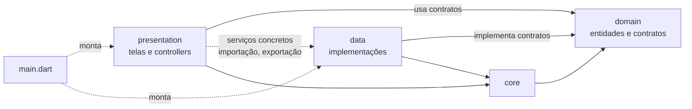

# Arquitetura

O Lydo segue uma **Clean Architecture** simplificada: as regras e os contratos ficam no centro, a interface e o armazenamento ficam nas bordas.

## Camadas

| Pasta | Responsabilidade | Regra principal |
|---|---|---|
| `lib/domain` | Entidades (`DocumentEntry`, `Annotation`, `AppSettings`, `PagePlan`), regras puras (realce, remapeamento de páginas) e **contratos** dos repositórios (interfaces). | Dart puro, sem Flutter. Não sabe onde os dados são salvos. |
| `lib/data` | Implementações: repositórios em SharedPreferences e arquivos JSON, importação de PDFs e imagens, edição do PDF com PDFium (FFI). | Implementa os contratos do domínio. É o único lugar que toca em disco e em preferências. |
| `lib/presentation` | Telas (widgets) e **controllers** (`ValueNotifier`/`ChangeNotifier`) que guardam o estado da tela e chamam o domínio e os dados. | Sem regra de negócio dentro de `build()`. |
| `lib/core` | Utilitários compartilhados: `Result` com `AppFailure`, formatadores (tamanho de arquivo, "Hoje") e o renderizador de anotações usado tanto na tela quanto na exportação. | Sem estado. |
| `lib/main.dart` | **Raiz de composição**: cria os repositórios concretos, injeta nos controllers, monta o tema e a escala da interface. | É o único lugar que conhece as implementações ao mesmo tempo. |

## Diagrama de dependências

Leitura do diagrama: a presentation e a data **dependem do domain**, e não o contrário. As setas pontilhadas são exceções ou composição (ver abaixo).

### Exceções conhecidas

- **Serviços concretos usados pela presentation.** `PdfImportService`, `StampImportService` e `PdfEditService` ficam em `lib/data`, mas são chamados direto pelos controllers e pela página do leitor (sem contrato no domain). Os repositórios, ao contrário, sempre entram como interface.
- **`core` depende de `domain`.** `core/annotation_renderer.dart` desenha `Annotation` e usa o `pdfrx`/Flutter, então `core` não é Flutter-free.
- **`SharedPreferences` aparece em `main.dart`.** É a composição; fora dela, só `lib/data` deve tocar em preferências (regra do `CLAUDE.md`).

## Mapa: arquivo → responsabilidade

Baseado na seção 2 da [MEMORIA](../MEMORIA.md).

### `lib/` raiz e `core/`

| Arquivo | Responsabilidade |
|---|---|
| `main.dart` | Monta repositórios, controllers, tema e escala da interface. |
| `core/result.dart` | `Result<T>` (`Ok`/`Err`), `AppFailure` e `FailureKind`. |
| `core/formatters.dart` | `formatBytes` ("4,2 MB") e `formatRelativeDay` ("Hoje"). |
| `core/annotation_renderer.dart` | `paintAnnotations()`, usado na tela e na exportação, e `AnnotationImageCache`. |

### `domain/`

| Arquivo | Responsabilidade |
|---|---|
| `document_entry.dart` | PDF da biblioteca e sua posição (página, matriz, favorito, tamanho). |
| `library_repository.dart` | Contrato da biblioteca. |
| `app_settings.dart` | Ajustes: tema, escala, rolagem, retomar, tela ligada e grade. |
| `settings_repository.dart` | Contrato dos ajustes. |
| `annotation.dart` | `Annotation`, `APoint`, `ARect`, `remapAnnotations()`, `stampRect()` e `highlightRects()` (realce que gruda no texto). |
| `annotation_repository.dart` | Contrato das anotações. |
| `page_plan.dart` | `PagePlan` e `PageSlot`: nova ordem das páginas e giros (Organizar páginas). |
| `signature_repository.dart` | Contrato das assinaturas salvas (`SavedSignature`). |

### `data/`

| Arquivo | Responsabilidade |
|---|---|
| `prefs_library_repository.dart` | Biblioteca em SharedPreferences (chave `library.v1`). |
| `prefs_settings_repository.dart` | Ajustes em SharedPreferences (chave `settings.v1`). |
| `json_annotation_repository.dart` | Anotações em `<docs>/annotations/<id>.json`, uma por documento. |
| `pdf_import_service.dart` | Seletor de arquivo, cópia para `<docs>/pdfs/<id>.pdf` e impressão digital. |
| `pdf_edit_service.dart` | **Delicado (FFI PDFium):** `applyPagePlan` e `exportWithAnnotations`. |
| `stamp_import_service.dart` | Fotos e assinaturas copiadas para `<docs>/stamps/`, com a proporção. |
| `file_signature_repository.dart` | Assinaturas em PNG, em `<docs>/signatures/`. |

### `presentation/`

| Arquivo | Responsabilidade |
|---|---|
| `theme/lydo_theme.dart` | `LydoColors`, tema claro e escuro, `LydoLogo` e a extensão `context.*`. |
| `shell/app_shell.dart` | Barra inferior: Arquivos, Ferramentas e Ajustes. |
| `home/home_controller.dart` | `HomeState` (busca, filtros, "Continuar lendo") e ações da biblioteca. |
| `home/home_page.dart` | Tela Arquivos: lista ou grade, menu ⋮ e capa do documento (`DocumentCover`). |
| `tools/tools_page.dart` | Vitrine "em breve" da aba Ferramentas. |
| `settings/settings_controller.dart` | Estado dos ajustes e acesso ao repositório. |
| `settings/settings_page.dart` | Tela Ajustes. |
| `reader/reader_controller.dart` | Página atual, busca (`PdfTextSearcher`), salvar posição, modo noturno e layout horizontal. |
| `reader/reader_page.dart` | Leitor: barra superior, abas Ler/Anotar/Editar, miniaturas e diálogos. |
| `reader/annotation_controller.dart` | Ferramenta, cor, espessura, desfazer/refazer e o traço em andamento. |
| `reader/annotation_layer.dart` | Overlays de texto e nota, gestos de desenho e barra do modo Anotar. |
| `reader/edit_toolbar.dart` | Barra do modo Editar (Imagem, Assinar, Páginas, Exportar). |
| `edit/signature_pad_controller.dart` e `signature_pad_page.dart` | Tela de desenhar assinatura, com PNG 3x e fundo transparente. |
| `edit/signature_picker_sheet.dart` | Escolher uma assinatura salva ou criar uma nova. |
| `edit/page_organizer_controller.dart` e `page_organizer_page.dart` | Organizar páginas (girar, excluir, arrastar). Devolve um `PagePlan`. |

### Outros arquivos

| Arquivo | Responsabilidade |
|---|---|
| `test/*.dart` | Testes unitários e de widget (ver [Desenvolvimento](desenvolvimento.md#testes)). |
| `*.png` na raiz | Telas de referência do design. Nas imagens, o nome antigo do app é "Forma PDF". |

## Padrões

### Controllers com `ValueNotifier`

- Estado de tela fica em controllers (`HomeController`, `SettingsController`, `ReaderController`, `AnnotationController`, `PageOrganizerController`, `SignaturePadController`).
- Cada valor observável é um `ValueNotifier`, e a tela usa `ValueListenableBuilder` para reconstruir só a parte que mudou.
- Não há Bloc, Riverpod, GetX nem Provider. Essa escolha vem do `CLAUDE.md`.
- Recursos (notifiers, controllers do PDF, wakelock) são liberados no `dispose()`.

### Erros com `Result` tipado

- Repositórios e serviços devolvem `Result<T>`: `Ok(valor)` ou `Err(AppFailure)`.
- `AppFailure` tem um `FailureKind` (`fileNotFound`, `importFailed`, `storage` ou `unknown`) e uma **mensagem pronta em pt-BR** para mostrar ao usuário.
- Exceção não chega à interface: quem chama faz `switch` no `Result`.

### Persistência

- Dados pequenos e frequentes ficam em **SharedPreferences**, como JSON: biblioteca e ajustes.
- Dados grandes ficam em **arquivos JSON** por documento: anotações. Um traço de caneta pode ter milhares de pontos, e o SharedPreferences carrega tudo na memória a cada leitura.
- Arquivos são gravados com **escrita atômica**: primeiro um `.tmp`, depois `rename`. Se o app fechar no meio, o arquivo antigo continua íntegro.
- **Nada de banco** (Hive, Isar, sqflite ou Drift) sem decisão do Franklin.

### Identidade do documento

O `id` de cada PDF é uma impressão digital do conteúdo (FNV-1a dos primeiros 64 KB + tamanho), e não o nome do arquivo. Detalhes em [Funcionalidades](funcionalidades.md#retomar-leitura).

## Onde cada dado é salvo

| Dado | Onde | Formato | Quem grava |
|---|---|---|---|
| Biblioteca (lista de PDFs, página, zoom, favorito) | SharedPreferences, chave `library.v1` | Lista JSON de `DocumentEntry` | `PrefsLibraryRepository` |
| Ajustes | SharedPreferences, chave `settings.v1` | Objeto JSON de `AppSettings` | `PrefsSettingsRepository` |
| PDFs importados | `<docs>/pdfs/<id>.pdf` | PDF (cópia) | `PdfImportService`; também `applyPagePlan`, que cria `<id>_<timestamp>.pdf` |
| Anotações de cada documento | `<docs>/annotations/<id>.json` | Lista JSON de `Annotation` | `JsonAnnotationRepository` |
| Assinaturas salvas | `<docs>/signatures/<microssegundos>.png` | PNG com fundo transparente | `FileSignatureRepository` |
| Cópias de imagens e assinaturas usadas | `<docs>/stamps/<microssegundos>.<ext>` | PNG ou JPG | `StampImportService` |

`<docs>` é a pasta de documentos do app, obtida pelo `path_provider`.

Os PDFs exportados não ficam no app: são entregues ao seletor de "Salvar" do Android, na escolha da pessoa.

## Ver também

- [Funcionalidades](funcionalidades.md): como cada recurso usa essas camadas.
- [Desenvolvimento](desenvolvimento.md): como rodar e testar.
